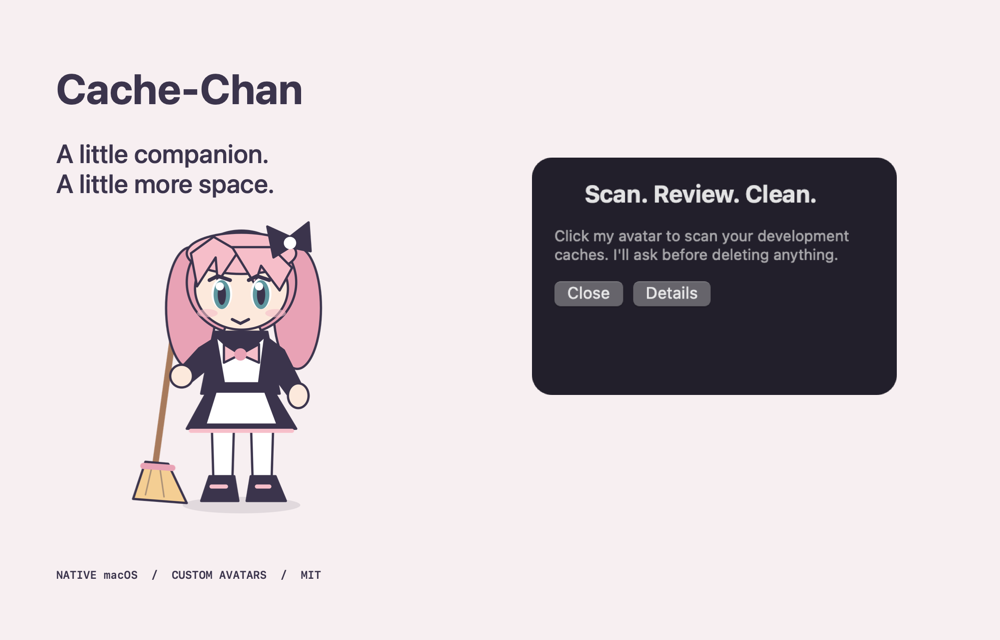

<p align="center">
  
</p>

<h1 align="center">Cache-Chan</h1>
<p align="center"><strong>A little companion. A little more space.</strong></p>
<p align="center">An anime-inspired macOS desktop buddy that helps you reclaim development cache space.</p>

<p align="center">
  <a href="LICENSE"></a>
  
  
  
</p>



## Meet your new desktop buddy

Leave Cache-Chan on your desktop and click her avatar to scan immediately. A small speech bubble asks whether to clean; click **Clean** to confirm, or **Later** to leave everything untouched. Pick your own character image to make the companion yours.

- **A full-body friend.** A transparent chibi character with a broom, from hair bow to boots. Click once to scan, then answer a compact speech bubble.
- **A little personality.** Breathing, blinking, glancing, waving and tilting while idle. A moving broom while working. A two-hop happy dance with sparkles when done. Respects macOS Reduce Motion.
- **Your character, your desk.** Choose a local image and show it in full, with its aspect ratio and transparency preserved. No circular crop.
- **Know before you clean.** Scan fixed development cache locations and review their measured sizes before confirming.
- **See the result.** The cleaner reports removed cache size, remaining space and the actual available-space change.
- **Native and local.** Swift + AppKit. No account, administrator access, telemetry, network calls or automatic cleaning.

The showcase uses the actual native bubble view in a presentation state. Cache sizes are measured from your machine when you scan; no reclaimed-space claim is fabricated.

<p align="center"></p>

Hover to say hello, or use **Wave hello** / **Happy dance** in the right-click menu to preview actions. Default character frames are cached once. The animation clock checks state at 12 Hz; idle artwork redraws only when the pose or blink changes, while breathing uses Core Animation.

## Run it

Requires macOS 11 or newer and Xcode or Xcode Command Line Tools with a Swift compiler that supports `@main`.

```sh
git clone https://github.com/guoxianzhe/cache-cleaner.git
cd cache-cleaner
bash build.sh --run
```

The build creates `build/Cache-Chan.app`, runs an isolated self-test and applies an ad-hoc local signature. Double-click the app later or copy it into Applications. This is a source-built app, not a Developer ID signed or notarized download.

## The tiny controls

| Action | What happens |
| --- | --- |
| Click avatar | Scan every time and show a speech bubble; while busy, show the current progress |
| Drag avatar | Move it; placement is saved and clamped to a visible screen |
| Right-click avatar | Change/reset avatar, open cleaner, About or Quit |
| Menu bar sparkle | The same controls, even if the cleaner is closed |
| Scan again | Refresh the per-directory estimate without deleting anything |
| Clean in bubble | Confirm permanent deletion of the scanned cache targets, with no second modal |
| Later / Close | Dismiss the bubble without starting cleanup; an ongoing cleanup continues |
| Details | Open the per-directory breakdown and result/error report |

Your image is copied as a proportionally resized PNG to `~/Library/Application Support/Cache-Chan/companion.png`. The original stays untouched. Transparent PNGs work best for a full-body companion. The default mascot can be restored with **Reset avatar**. Custom images are never uploaded; their rights remain with their respective owners. Blinking and hand-pose changes are exclusive to the original vector character; custom images are static artwork with the working sway and completion hop.

Version 0.4 uses a new full-image preference. Older circular avatar copies are kept untouched; select the original image again to use it without cropping.

## What's on the menu?

Only these fixed paths under the current user's home are eligible:

| Tool | Cache paths |
| --- | --- |
| Codex | `Library/Application Support/Codex/Crashpad/pending` |
| uv | `.cache/uv` |
| VS Code C++ | `Library/Caches/vscode-cpptools` |
| Gradle | `.gradle/caches`, `.gradle/.tmp`, `.gradle/daemon` |
| npm / npx | `.npm/_cacache`, `.npm/_npx` |
| CocoaPods / Yarn | `Library/Caches/CocoaPods`, `Library/Caches/Yarn` |
| Electron / Playwright / TypeScript | `Library/Caches/electron`, `Library/Caches/ms-playwright`, `Library/Caches/typescript` |

**Deletion is permanent, not a move to Trash.** Quit active builds and affected tools first. Packages, browsers and indexes may need to download or rebuild afterwards. Source code, Git worktrees, chat files, Codex conversations and Docker data are outside this scope.

Symbolic links in a target or its parent path are rejected before measurement and again before cleanup. Inaccessible locations are reported and skipped. Do not replace target paths while cleaning: this small utility does not lock the filesystem against concurrent directory changes.

Disk estimates use `du -sk`. APFS shared blocks and other apps' activity mean removed cache size and available disk space can differ. Scanning/cleanup runs in the background and disables action buttons until completion.

## Build, check, hack

```sh
bash build.sh
build/Cache-Chan.app/Contents/MacOS/CacheCleaner --self-test
```

The self-test covers path boundaries, symbolic-link rejection, capacity formatting, mascot PNG rendering, animation teardown and deletion in a disposable test directory. It never deletes real development caches. Also test clicking, dragging, avatar selection and the bubble's **Later** path after UI changes.

To regenerate the repository artwork:

```sh
mkdir -p docs
build/Cache-Chan.app/Contents/MacOS/CacheCleaner --export-avatar docs/mascot.png
build/Cache-Chan.app/Contents/MacOS/CacheCleaner --preview docs/showcase.png
build/Cache-Chan.app/Contents/MacOS/CacheCleaner --export-motion docs/motion.gif
```

Contributions welcome: see [CONTRIBUTING.md](CONTRIBUTING.md). Have an idea for a companion or a new cache target? [Open an issue](https://github.com/guoxianzhe/cache-cleaner/issues). If Cache-Chan makes your desk a little happier, a star helps others find her.

## License

Copyright © 2026 [guoxianzhe](https://github.com/guoxianzhe). Code and the original default mascot are released under the [MIT License](LICENSE). No third-party anime characters are bundled. See [CHANGELOG.md](CHANGELOG.md) for release notes.
